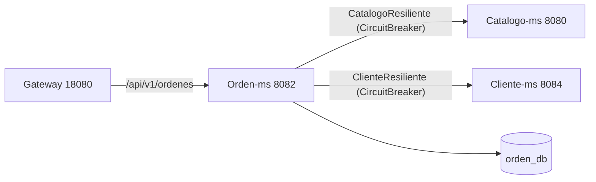
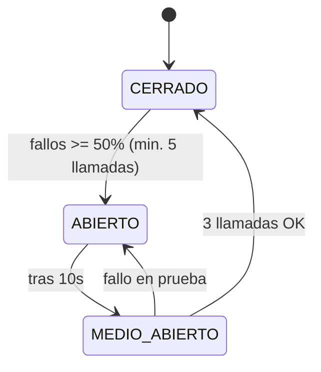

# Sesión 6 — Comunicación síncrona resiliente

Objetivo: que `qhalimenu-orden-ms` consulte a otros microservicios (Catálogo y Cliente) mediante
**OpenFeign**, y que esas llamadas no degraden la creación de órdenes cuando un servicio remoto
falla o tarda demasiado, aplicando **Circuit Breaker** y **TimeLimiter** de Resilience4j.

## Componentes

| Pieza | Archivo |
|---|---|
| Cliente Feign de catálogo | `services/qhalimenu-orden-ms/src/main/java/pe/edu/upeu/orden/client/CatalogoClient.java` |
| Cliente Feign de cliente | `services/qhalimenu-orden-ms/src/main/java/pe/edu/upeu/orden/client/ClienteClient.java` |
| Envoltura resiliente catálogo | `services/qhalimenu-orden-ms/src/main/java/pe/edu/upeu/orden/resilience/CatalogoResiliente.java` |
| Envoltura resiliente cliente | `services/qhalimenu-orden-ms/src/main/java/pe/edu/upeu/orden/resilience/ClienteResiliente.java` |
| Configuración de tiempos Feign | `config-repo/qhalimenu-orden-ms-dev.yml` (`spring.cloud.openfeign`) |
| Configuración Resilience4j | `config-repo/qhalimenu-orden-ms-dev.yml` (`resilience4j`) |

## Flujo



Al crear una orden, `orden-ms` valida el cliente (`ClienteClient`) y los productos/precios
(`CatalogoClient`). Cada llamada se realiza a través de una clase `*Resiliente` que envuelve la
invocación Feign. Si el remoto falla o excede el tiempo límite, se aplica una **degradación**
controlada en lugar de propagar el error.

## Resiliencia programática

El Circuit Breaker se usa de forma **programática** (a través de `CircuitBreakerFactory`), no con la
anotación `@CircuitBreaker`. Esto permite elegir el valor de respaldo (fallback) en el mismo punto de
llamada y mantener el control del flujo.

Parámetros (compartidos para las instancias `catalogo` y `cliente`):

| Parámetro | Valor |
|---|---|
| `sliding-window-type` | `COUNT_BASED` |
| `sliding-window-size` | `5` |
| `minimum-number-of-calls` | `5` |
| `failure-rate-threshold` | `50` (%) |
| `wait-duration-in-open-state` | `10s` |
| `permitted-number-of-calls-in-half-open-state` | `3` |
| `automatic-transition-from-open-to-half-open-enabled` | `true` |
| `register-health-indicator` | `true` |

TimeLimiter (por instancia):

| Parámetro | Valor |
|---|---|
| `timeout-duration` | `4s` |
| `cancel-running-future` | `true` |

Tiempos de red Feign (globales):

```yaml
spring:
  cloud:
    openfeign:
      client:
        config:
          default:
            connect-timeout: 2000
            read-timeout: 4000
```

## Máquina de estados del Circuit Breaker



## Pruebas

- `pe.edu.upeu.orden.resilience.CatalogoResilienteTest`
- `pe.edu.upeu.orden.resilience.ClienteResilienteTest`

Verifican la respuesta exitosa y la degradación (fallback) cuando el servicio remoto falla.

## Ejecución

```powershell
cd services\qhalimenu-orden-ms
.\mvnw.cmd test
```

El estado de los circuitos puede observarse vía Actuator: `GET http://localhost:8082/actuator/health`.
