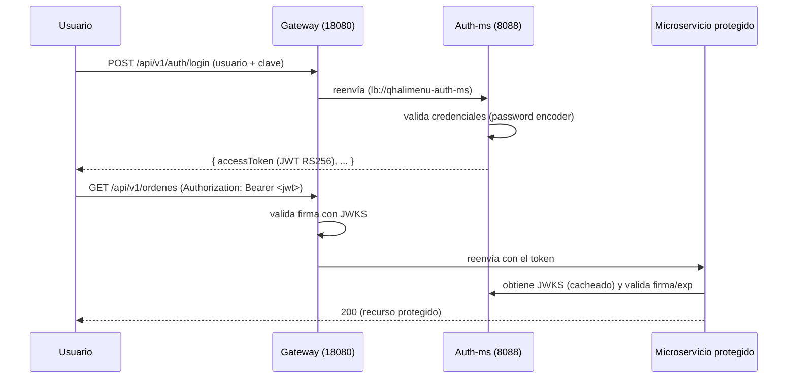

# Sesión 7 — Seguridad con JWT (RS256 / JWKS)

Objetivo: proteger los endpoints del sistema con **tokens JWT firmados con RSA (RS256)**,
emitidos por un microservicio de autenticación (`qhalimenu-auth-ms`) y validados de forma
descentralizada por cada microservicio y por el Gateway mediante **JWKS** (clave pública).

## Componentes (`services/qhalimenu-auth-ms`)

| Pieza | Archivo |
|---|---|
| Generación/gestión de claves RSA | `src/main/java/pe/edu/upeu/auth/security/RsaKeyProvider.java` |
| Emisión y JWKS | `src/main/java/pe/edu/upeu/auth/security/JwtService.java` |
| Endpoints de autenticación | `src/main/java/pe/edu/upeu/auth/controller/AuthController.java` |
| Servicio de login/registro | `src/main/java/pe/edu/upeu/auth/service/AuthService.java` |
| Configuración de seguridad | `src/main/java/pe/edu/upeu/auth/config/SecurityConfig.java` |
| Datos semilla | `src/main/java/pe/edu/upeu/auth/config/DataInitializer.java` |

## Flujo de autenticación



## Claves RSA y JWKS

- El par de claves se carga desde variables de entorno:

  ```yaml
  qhalimenu:
    jwt:
      issuer: qhalimenu-auth-ms
      expiracion-segundos: 3600
      private-key: ${JWT_PRIVATE_KEY:}
      public-key: ${JWT_PUBLIC_KEY:}
  ```

- Si no se configuran, `RsaKeyProvider` genera un par **efímero en memoria** (apto solo para
  pruebas: los tokens dejan de ser válidos al reiniciar el servicio).
- La clave pública se expone en formato **JWKS** en: `GET http://localhost:8088/api/v1/auth/jwks`.
- Los servicios y el Gateway configuran `spring.security.oauth2.resourceserver.jwt.jwk-set-uri`
  apuntando a ese endpoint.

Genera un par de claves persistente con:

```powershell
powershell -ExecutionPolicy Bypass -File .\scripts\generate-jwt-keys.ps1
```

El script crea `secrets/jwt-private.pem` y `secrets/jwt-public.pem` (ignorados por git) y muestra
los valores listos para exportar como `JWT_PRIVATE_KEY` / `JWT_PUBLIC_KEY`.

## Endpoints de Auth

| Método | Ruta | Descripción |
|---|---|---|
| `POST` | `/api/v1/auth/login` | Autentica y devuelve el JWT |
| `POST` | `/api/v1/auth/registro` | Registra un usuario nuevo (201) |
| `GET` | `/api/v1/auth/jwks` | Clave pública para validación (JWKS) |

## Usuarios semilla

Creados por `DataInitializer` si no existen:

| Usuario | Clave | Roles | `idCliente` |
|---|---|---|---|
| `admin` | `admin123` | `ADMIN` | — |
| `cliente1` | `cliente123` | `CLIENTE` | `1` |

## Protección por servicio

- **Gateway**: Resource Server. Valida el JWT antes de enrutar; las rutas que requieren token se
  rechazan sin `Authorization` válido.
- **orden-ms / cliente-ms / pago-ms**: Resource Server. Validan el JWT contra el JWKS.
- **cliente-ms**: aplica **ownership** — un cliente solo accede a sus propios recursos.
- **pago-ms**: no implementa ownership propio; la titularidad de la orden se garantiza en `orden-ms`.

## Pruebas

- `services/qhalimenu-auth-ms/.../AuthServiceTest`, `JwtServiceTest` (5 pruebas).
- `services/qhalimenu-orden-ms/.../OrdenSeguridadTest` (5 pruebas).
- `services/qhalimenu-pago-ms/.../PagoSeguridadTest` (8 pruebas).
- `services/qhalimenu-cliente-ms` (7 pruebas, incluye ownership).
- `infra/qhalimenu-gateway` (1 prueba).

## Ejecución

```powershell
# 1) (Opcional pero recomendado) claves persistentes
.\scripts\generate-jwt-keys.ps1
# exportar JWT_PRIVATE_KEY / JWT_PUBLIC_KEY en la terminal antes de arrancar auth-ms

# 2) Auth
cd services\qhalimenu-auth-ms
.\mvnw.cmd spring-boot:run
```

Ejemplo de login a través del Gateway:

```powershell
curl -X POST http://localhost:18080/api/v1/auth/login `
  -H "Content-Type: application/json" `
  -d '{"username":"admin","password":"admin123"}'
```
