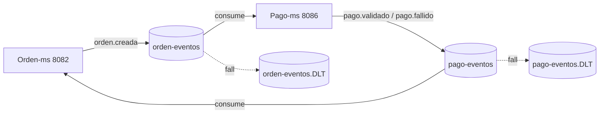
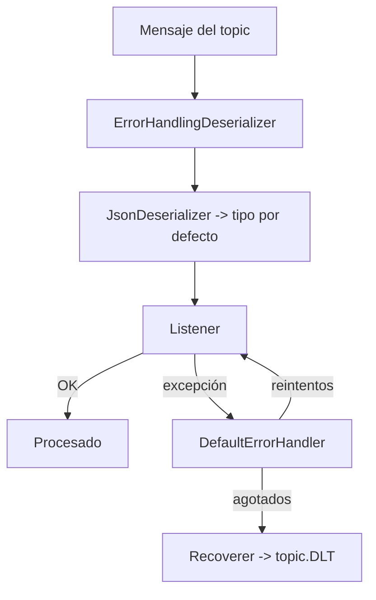

# Sesión 8 — Mensajería asíncrona con Apache Kafka

Objetivo: desacoplar `orden-ms` y `pago-ms` mediante un **broker Apache Kafka** en modo KRaft,
publicando y consumiendo eventos de dominio en formato JSON, con manejo de errores mediante
**Dead Letter Topic (DLT)**.

## Infraestructura

| Pieza | Valor |
|---|---|
| Imagen | `apache/kafka:3.8.1` (KRaft, sin Zookeeper) |
| Archivo compose | `infra/kafka/compose-dev.yml` |
| Listener externo (host) | `localhost:19092` |
| Listener interno (contenedores) | `kafka:9092` |
| Controller | `9093` |
| Kafka UI | `http://localhost:18085` (`provectuslabs/kafka-ui`) |
| Volumen | `qhalimenu_kafka_data` |
| `CLUSTER_ID` | `MkU3OEVBNTcwNTJENDM2Qk` |

Los microservicios se conectan al broker con `spring.kafka.bootstrap-servers: localhost:19092`.

## Topics y eventos

| Topic | Productor | Consumidor | Eventos |
|---|---|---|---|
| `orden-eventos` | `orden-ms` | `pago-ms` | `orden.creada` |
| `pago-eventos` | `pago-ms` | `orden-ms` | `pago.validado`, `pago.fallido` |
| `orden-eventos.DLT` | recoverer | (inspección manual / UI) | mensajes que fallan al procesar `orden-eventos` |
| `pago-eventos.DLT` | recoverer | (inspección manual / UI) | mensajes que fallan al procesar `pago-eventos` |

Los topics se declaran con `NewTopic` (3 particiones, 1 réplica) y los `.DLT` con 1 partición.
Ambos servicios declaran los topics que producen y consumen para no depender del auto-creado.

### Cargas útiles

`orden.creada` (`OrdenCreadaEvento`):

```json
{
  "eventoId": "uuid",
  "tipo": "orden.creada",
  "ordenId": 1,
  "idCliente": 1,
  "total": 25.50,
  "metodoPago": "MERCADOPAGO",
  "momentoPago": "ANTICIPADO",
  "estado": "PENDIENTE_PAGO",
  "ocurridoEn": "2026-01-01T12:00:00Z",
  "items": [ { "idProducto": 3, "cantidad": 2, "precioUnitario": 12.75 } ]
}
```

`pago.validado` / `pago.fallido` (`PagoValidadoEvento`):

```json
{
  "eventoId": "uuid",
  "tipo": "pago.validado",
  "ordenId": 1,
  "pagoId": 10,
  "preferenceId": "SIM-...",
  "monto": 25.50,
  "estadoPago": "PROCESADO",
  "ocurridoEn": "2026-01-01T12:05:00Z"
}
```

> Las clases de evento están **duplicadas por servicio** (no hay librería compartida), de modo que
> cada microservicio evoluciona su propio contrato.

## Diagrama de mensajería



## Configuración de productor y consumidor

Productor (`config-repo/*-dev.yml`):

```yaml
spring:
  kafka:
    bootstrap-servers: localhost:19092
    producer:
      key-serializer: org.apache.kafka.common.serialization.StringSerializer
      value-serializer: org.springframework.kafka.support.serializer.JsonSerializer
      acks: all
      properties:
        enable.idempotence: true
        spring.json.add.type.headers: false
    consumer:
      group-id: qhalimenu-<servicio>
      auto-offset-reset: earliest
    listener:
      ack-mode: record
```

- `spring.json.add.type.headers: false`: los mensajes **no** llevan cabecera de tipo; cada
  consumidor fija su tipo por defecto.
- `enable.idempotence: true` + `acks: all`: evita duplicados a nivel de productor.

Consumidor (`KafkaConsumerConfig` de cada servicio):

- `ErrorHandlingDeserializer` envolviendo un `JsonDeserializer`.
- El `JsonDeserializer` usa el **tipo por defecto** del servicio (`OrdenCreadaEvento` en `pago-ms`,
  `PagoValidadoEvento` en `orden-ms`) y `trusted-packages` restringidos.
- `DefaultErrorHandler` con `DeadLetterPublishingRecoverer` que publica el mensaje fallido en
  `<topic>.DLT` y `FixedBackOff(0, 2)` (2 reintentos).



## Pruebas

- `pe.edu.upeu.pago.KafkaMensajeriaTest` (3 pruebas, con `@EmbeddedKafka`).
- `pe.edu.upeu.pago.SagaPagoTest` (validación de extremo a extremo del consumo de `orden-eventos`).
- `pe.edu.upeu.orden.OrdenSagaListenerTest` (validación del consumo de `pago-eventos`).
- `pe.edu.upeu.orden.OrdenEventoPublisherTest`.

Estas pruebas verifican, entre otros, que un evento **publicado a través del Outbox** (JSON con
fechas ISO-8601) es **deserializado correctamente** por el consumidor real del otro servicio.

## Levantar Kafka (DEV)

```powershell
docker compose -f infra\kafka\compose-dev.yml up -d
```

- Broker: `localhost:19092`
- Kafka UI: `http://localhost:18085`

Detener:

```powershell
docker compose -f infra\kafka\compose-dev.yml down
```
