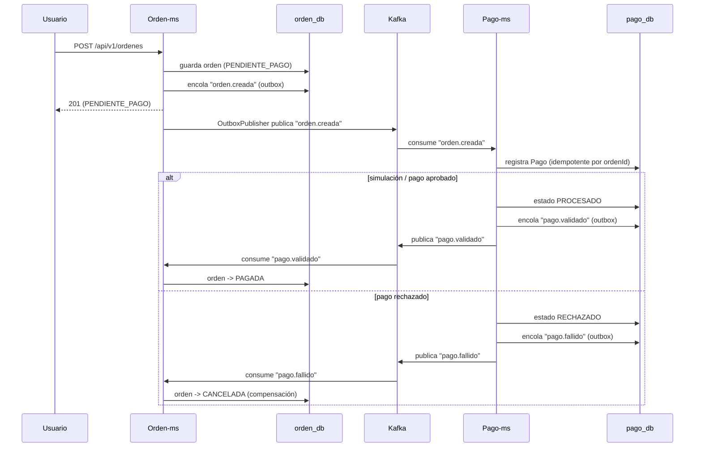
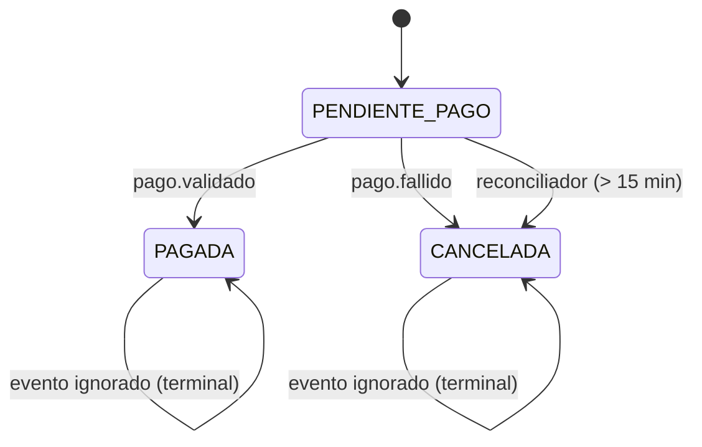

# Sesión 9 — Patrón SAGA coreografiado (+ Outbox y reconciliación)

Objetivo: coordinar el flujo **Orden → Pago → confirmación** de forma distribuida mediante una
**SAGA coreografiada**: cada servicio reacciona a los eventos de los demás y compensa cuando algo
falla. Se garantiza la entrega fiable de eventos con el **patrón Outbox** y se cubren los casos
colgados con un **reconciliador**.

## Participantes y estados

- **orden-ms**: crea la orden en estado `PENDIENTE_PAGO` y publica `orden.creada`.
- **pago-ms**: al recibir `orden.creada`, registra un `Pago` (idempotente por `ordenId`). Según el
  resultado, publica `pago.validado` o `pago.fallido`.
- **orden-ms**: al recibir el evento de pago, aplica la transición de estado correspondiente.

Estados de la orden:

| Estado | Significado |
|---|---|
| `PENDIENTE_PAGO` | Orden creada, esperando resultado del pago |
| `PAGADA` | Pago confirmado |
| `CANCELADA` | Pago rechazado o tiempo de espera agotado (compensación) |

## Diagrama de la SAGA



## Patrón Outbox

Para no perder eventos si el broker está caído, el evento se guarda en la **misma transacción** que
el cambio de estado y luego un publicador programado lo envía a Kafka:

| Pieza | orden-ms | pago-ms |
|---|---|---|
| Entidad | `entity/OutboxEvento.java` | `entity/OutboxEvento.java` |
| Repositorio | `repository/OutboxEventoRepository.java` | `repository/OutboxEventoRepository.java` |
| Encolado en tx | `outbox/OutboxEventoService.java` | `outbox/OutboxEventoService.java` |
| Publicador programado | `outbox/OutboxPublisher.java` | `outbox/OutboxPublisher.java` |
| Migración | `db/migration/V3__create_outbox_table.sql` | `db/migration/V3__create_outbox_table.sql` |

Detalles del publicador:

- `@Scheduled` con `poll-delay-ms: 2000` e `initial-delay-ms: 3000`.
- Publica con `KafkaTemplate<String,String>`; el JSON se serializa con Jackson2 (`JavaTimeModule`,
  `WRITE_DATES_AS_TIMESTAMPS=false`) para producir fechas **ISO-8601**.
- Marca el evento como `PUBLICADO` solo tras confirmar el envío (`send(...).get(10s)`).

```mermaid
flowchart LR
    A[Cambio de estado + encolar] -->|misma transacción| DB[(tabla outbox_eventos)]
    DB -->|@Scheduled| PB[OutboxPublisher]
    PB -->|send + get| K[(Kafka)]
    PB -->|marca PUBLICADO| DB
```

## Idempotencia

- **pago-ms**: `registrarPagoDesdeOrden` usa `findFirstByOrdenId`; si ya existe un pago para la
  orden, ignora el evento (reenvíos de Kafka no duplican pagos).
- **pago-ms**: la publicación de eventos solo ocurre cuando el estado del pago **cambia**
  (`publicarEventoSiCambioDeEstado`), evitando reemitir `pago.validado`/`pago.fallido`.
- **orden-ms**: `aplicarResultadoPago` solo transiciona si la orden está en `PENDIENTE_PAGO`.
  Si ya es terminal (`PAGADA`/`CANCELADA`), el evento se ignora. Esto evita que un
  `pago.fallido` tardío cancele una orden **ya pagada**.



## Compensación

La compensación de la SAGA es la transición `PENDIENTE_PAGO → CANCELADA`. Ocurre cuando:

1. `pago-ms` publica `pago.fallido` (pago rechazado por el proveedor o feedback/ webhook negativo).
2. El **reconciliador** de `orden-ms` detecta órdenes en `PENDIENTE_PAGO` con más de
   `saga.timeout-minutos` (15) minutos y las cancela.

En `pago-ms`, cualquier transición a estado terminal (`PROCESADO` o `RECHAZADO`) —vía escucha de
`orden.creada`, `confirmarSimulacion`, `feedback` o `webhook`— provoca la publicación del evento
correspondiente a través del Outbox.

## Reconciliador

`orden-ms/reconciliacion/OrdenReconciliador.java`:

- `@Scheduled` con `reconciliacion-delay-ms: 60000` e `reconciliacion-initial-delay-ms: 30000`.
- Cancela órdenes `PENDIENTE_PAGO` cuya antigüedad supere `saga.timeout-minutos` (15).

## Configuración

```yaml
qhalimenu:
  kafka:
    topic:
      orden-eventos: orden-eventos
      pago-eventos: pago-eventos
  outbox:
    poll-delay-ms: 2000
    initial-delay-ms: 3000
  saga:
    timeout-minutos: 15
    reconciliacion-delay-ms: 60000
    reconciliacion-initial-delay-ms: 30000
```

## Pruebas

| Módulo | Clase | Qué valida |
|---|---|---|
| orden-ms | `OrdenSagaListenerTest` | Consumo de `pago-eventos` (incl. evento publicado por Outbox) → `PAGADA` |
| orden-ms | `OrdenReconciliadorTest` | Cancelación por timeout |
| orden-ms | `OrdenServiceTest` | Transiciones e idempotencia (no cancelar una orden ya pagada) |
| pago-ms | `SagaPagoTest` | `orden.creada` (incl. vía Outbox) → registra y valida el pago |
| pago-ms | `KafkaMensajeriaTest` | Publicación/consumo y DLT |

## Limitaciones conocidas

- **Ruta REST `crear-preferencia` y SAGA**: si una orden se paga por la ruta REST de
  `pago-ms` (`POST /api/v1/pagos/crear-preferencia`) y, además, llega `orden.creada` por Kafka,
  puede crearse más de un `Pago` para la misma orden: la idempotencia por `ordenId` solo aplica en
  la ruta de consumo de Kafka. En el flujo normal de la SAGA no se usa `crear-preferencia`
  (la orden nace de `orden-ms`).
- Las claves JWT efímeras (si no se exportan `JWT_PRIVATE_KEY`/`JWT_PUBLIC_KEY`) invalidan los
  tokens al reiniciar `auth-ms`.
- `JsonDeserializer` (Spring Kafka) está marcado como *deprecado-pero-funcional* en la versión
  actual; se mantiene por compatibilidad.

## Ejecución

```powershell
# Infra: PostgreSQL + Kafka
docker compose -f docker-compose.yml up -d
docker compose -f infra\kafka\compose-dev.yml up -d

# Servicios (en terminales separadas)
cd services\qhalimenu-orden-ms; .\mvnw.cmd spring-boot:run
cd services\qhalimenu-pago-ms;  .\mvnw.cmd spring-boot:run
```

Observa los topics y mensajes en Kafka UI: `http://localhost:18085`.
